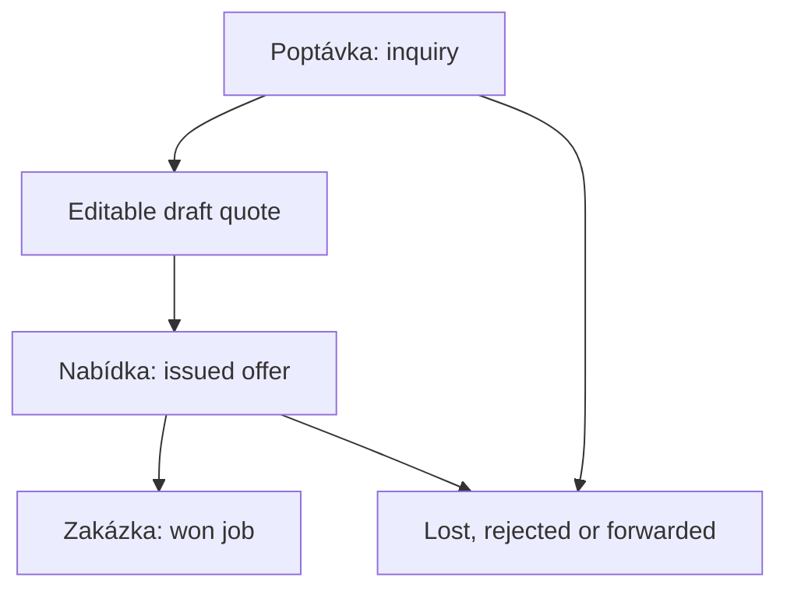

# Authentication, projects, and quotation lifecycle

**Status:** observed at the pinned revision; selected behavior characterized as
listed in [validation](validation.md). None of this is business-approved for
the rewrite.

## AUTH-01 — Identity and login

The main deployed path uses email/password with optional TOTP, not merely a
Cloudflare Access-protected website.

1. Startup calls `/api/me`; 401 opens login. Other failures can lead to the
   legacy local fallback
   ([startup](../../old/public/app.js#L32504-L32559)).
2. The browser derives a PBKDF2 verifier. The Worker stores a salted SHA-256
   hash of that verifier, not a conventional server-side password hash
   ([password helpers](../../old/worker.js#L28-L31)).
   The verifier is a password-equivalent credential; do not copy this custom
   scheme into the rewrite or place verifiers in fixtures.
3. Failed login is limited by email: eight attempts and a fifteen-minute
   blocking window
   ([constants](../../old/worker.js#L6-L9),
   [attempt tracking](../../old/worker.js#L372-L383)).
4. A successful password check either creates a session or returns a temporary
   second-factor ticket
   ([login](../../old/worker.js#L2699-L2746)).
5. Sessions last fourteen days. The raw token is an HttpOnly, Secure,
   SameSite=Lax cookie; its SHA-256 hash is stored in D1. Disabled/expired
   users are rejected
   ([session handling](../../old/worker.js#L107-L149)).
6. The client refreshes identity and rights after login so projects do not stay
   hidden until refresh
   ([post-login](../../old/public/app.js#L32074-L32105)).

### Enrollment, recovery, and MFA

- First-admin setup is allowed only when no users exist
  ([setup route](../../old/worker.js#L2580-L2588)).
- Invitations are single-use expiring tokens; the invitation path sets a
  password verifier and creates/activates an account
  ([invitation route](../../old/worker.js#L2749-L2779);
  [invitation schema](../../old/schema.sql#L133-L142)).
- Password recovery relies on Cloudflare Access email verification and
  verification of the Access JWT, not just trusting a supplied header.
  Reset invalidates existing sessions. A TOTP-enabled account must still log
  in with its second factor
  ([recovery](../../old/worker.js#L2591-L2696)).
- TOTP uses six digits, thirty-second steps, a ±one-step window and replay
  prevention. The second-step ticket lasts five minutes with five failed-code
  attempts. Mandatory enrollment can apply to nobody, administrators, or all
  users; backend access is restricted until enrollment
  ([TOTP policy](../../old/worker.js#L76-L105),
  [enforcement](../../old/worker.js#L2819-L2822)).

**Rewrite decision needed:** Q-01. Preserve the needed user workflows, not the
custom authentication implementation. Do not assume existing passwords can
be imported into a new identity provider.

## AUTH-02 — Authentication is not authorization

The legacy app has more than two roles:

- Users can hold multiple roles; server agenda permissions combine by taking
  the strongest grant (`zadne`, `cist`, `psat`).
- Superadmin bypasses the general agenda check.
- Frontend block/tab permissions and personal exceptions are maintained by the
  permission-matrix module; backend permission paths must also be inspected.
- Project-state visibility/editability adds another access dimension.

Sources: [role combination](../../old/worker.js#L289-L369),
[matrix persistence](../../old/schema.sql#L413),
[frontend state access](../../old/public/app.js#L18227-L18246),
[project API gate](../../old/worker.js#L3101-L3121).

Important separate capabilities include creating a project, viewing projects,
editing them, deleting them, editing quotes, approving margin exceptions,
viewing financial data, and editing catalogues.
Hiding a column or masking money in privacy mode is not a backend security
boundary. The [R-04 follow-up](system-map.md#risk-register) is still open.

**Rewrite decision needed:** Q-02. Start with a documented access matrix,
including denial tests, rather than copying all historic permission keys.

## PROJ-01 — One project, multiple commercial contexts

A project is stored in `poptavky`, a name left over from a separate inquiry
agenda. “Inquiry,” “offer,” and “won job” are stages of the same project, not
necessarily three separate entities
([API explanation](../../old/worker.js#L3101-L3104),
[project schema](../../old/schema.sql#L100-L124)).

A project can have multiple bidding customers (`uchazeci`). Each has an
identifier `u`, company and optional customer-directory ID. The configurator
uses the selected bidder as its customer, which also affects customer-class
markup and quote identity
([bidder context](../../old/public/app.js#L18960-L18977)).
Do not model “project = exactly one quote for exactly one customer” without
resolving Q-10.

## PROJ-02 — List and creation

The project list feeds a project workspace above the list; configuration is a
separate working view. Contract, documents and other ERP views are attached
tabs rather than separate copies of project data
([workspace responsibilities](../../old/public/app-proj.js#L1-L8),
[tabs](../../old/public/app-proj.js#L39-L54)).

The current create wizard has five steps: customer/site, email, documents,
similar-project check, and final action. Email/document steps can be skipped.
The UI requires a project name and customer, while the customer can initially
be free text and added to the directory later
([wizard](../../old/public/app.js#L20996-L21054)).

The save helper also requires name and customer
([client save](../../old/public/app.js#L18126-L18144)).
The server insert does not enforce the same nonempty fields in that handler
([server insert](../../old/worker.js#L4556-L4569)).
This discrepancy is not a requirement to allow invalid projects.

Project reads return at most 500 rows, then apply state visibility.
Do not reproduce this as silent truncation in a larger replacement
([list route](../../old/worker.js#L4495-L4510)).
Filters and layout preferences are UI concerns; the exact first-release
filters are Q-03.

### Numbering, duplicates, and retry safety

- The server assigns new-project numbers at insertion, ignoring a client
  preview of the next number.
- A form idempotency key returns the same project on resubmission.
- Unique-number collisions cause retries instead of overwriting another
  project.
- Similar names/addresses return a 409 with candidates unless explicitly
  confirmed. The wizard can add a customer as a bidder to an existing site.
- Number-series patterns, reset behavior and starting values are configurable.

Sources: [creation guards](../../old/worker.js#L4512-L4591),
[number series](../../old/worker.js#L938-L983),
[wizard alternatives](../../old/public/app.js#L21031-L21041).

Preserve retry safety even if the first UI is much simpler. Q-03 and SC-02 cover
the minimum create flow.

## PROJ-03 — Status and archive

The basic commercial path is:

This is a simplified explanation, **not** a complete transition specification.
Status definitions, phases, next steps and selection/tender phases are
different concepts. Default status semantics and names can be configured.

Opening configuration does not itself promote an inquiry to an offer
([project takeover](../../old/public/app.js#L18981-L18995)).
Issuing a locked quote promotes certain inquiry statuses to `Nabídka` on the
server ([promotion](../../old/worker.js#L5086-L5093)).
The client archives terminal statuses
([archive helper](../../old/public/app.js#L18176-L18178)).
Generic project updates also permit status/archive fields, so not every
transition is a strongly enforced state-machine operation
([update fields](../../old/worker.js#L4826-L4867)).

## QUOTE-01 — Drafts and editing

- A fresh project quote starts without a populated configuration. The user can
  add one manually, import positions, or use a configuration skeleton.
- Opening an existing draft resumes it by ID; defaults must not erase its
  specification or create another draft just by navigating.
- Delayed autosave includes configurations, distance, project/bidder context,
  import choices, print options, warning records, manual markups and price-list
  version decisions.
- Switching versions attempts to flush pending changes and cancels old saves
  so they cannot write into another version.

Sources: [open/resume/reset](../../old/public/app.js#L18872-L18958),
[save scheduling and payload](../../old/public/app.js#L19004-L19091).

There is a “slovo” single-editor/presence mechanism scoped by `cfg:<projectId>`,
with a sixty-second lease and handoff to another viewer
([lease helper](../../old/worker.js#L2558-L2571),
[handoff](../../old/worker.js#L2932-L2996)).
However, authors/admins can still update a draft without satisfying the same
lease check used to permit a colleague to save
([draft update](../../old/worker.js#L5227-L5242)).
Realtime subscriptions alone will not solve lost updates in the rewrite;
decide between an explicit edit lease and revision-checked saves (Q-15).

## QUOTE-02 — Issue, freeze, and copy

The UI calculates prices, checks margin approvals and blocking alerts, chooses
a quote version, generates a PDF, then posts a new locked record
([issue flow](../../old/public/app.js#L22576-L22664)).
Number format is project/bidder followed by quote revision, for example
`P2026-0009/2 – 1`. Draft and issued numbering are separate
([server numbering](../../old/worker.js#L5038-L5060)).
Server collisions return 409; the client regenerates the PDF with the new
number before retrying
([retry](../../old/public/app.js#L22650-L22674)).

An issued quote stores configuration inputs, a financial summary snapshot,
price/catalogue references and PDF bytes. A normal update to a locked quote
returns 409. The original PDF is read rather than recalculated
([snapshot](../../old/public/app.js#L22503-L22531),
[PDF route and update guard](../../old/worker.js#L5208-L5230)).
There are privileged PDF-replacement and deletion paths, so “immutable” is the
normal workflow, not an absolute historical-storage guarantee.

Creating an editable copy is intended to create a new draft, leaving the
original revision intact. Viewing uses the old summary snapshot; copying
checks whether price lists have changed
([open/copy behavior](../../old/public/app.js#L30135-L30195)).

After issue, the client links the project to that quote and selects it as
`platna_cn` if none was selected
([selection](../../old/public/app.js#L22678-L22693)).
Issue and project selection are separate requests, not one atomic business
operation. This is a design concern for the replacement.

Q-08 and Q-09 must establish whether official PDFs, approvals and locked
revisions belong in the first usable release. Internal price previews must
never be presented as an approved commercial offer.
