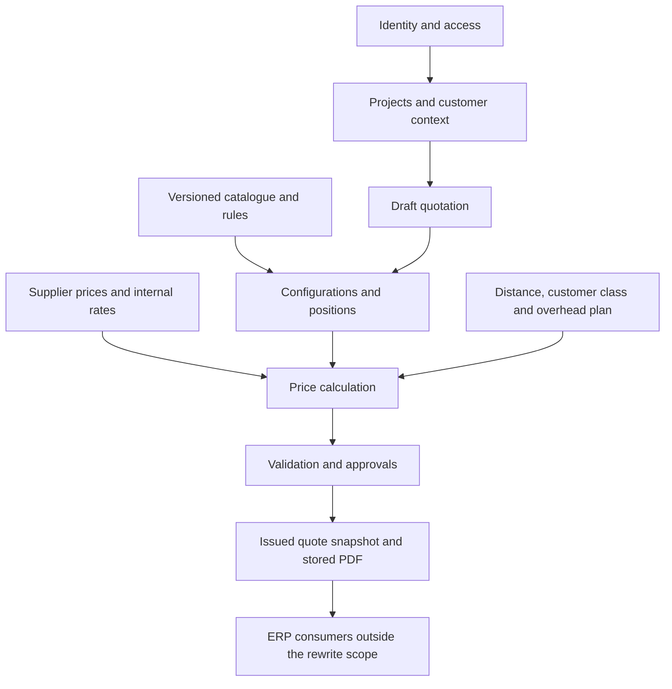

# Legacy system map

**Evidence:** first source-analysis pass, 2026-11-09. Source commit
`118bad3b390bf2785be0c16c8fe366fb3ecd2003`, application `1.256.2`.
This is a scoped investigation, not an exhaustive audit of the ERP.

## What the system is

The app describes itself as logic transferred from `Konfigurace_2_6.xlsm`
([frontend header](../../old/public/app.js#L1-L8)).
It has grown into an ERP-like application for shading products, project
management, sales quotations, installation, and finance.

The deployed shape is static HTML/JavaScript plus a Cloudflare Worker and D1
database ([deployment configuration](../../old/wrangler.toml#L1-L14)).
There is no React/TypeScript frontend or conventional application build in the
legacy package; the [package manifest](../../old/package.json#L1-L5) declares
`jsdom`, and regression checks are standalone scripts.

The core business calculator is in the **browser**, mixed with UI rendering,
global state, catalogue editing, persistence, and other modules.
The Worker authenticates users and stores much of the calculator's submitted
output rather than calculating quotes itself
([quote insert](../../old/worker.js#L5046-L5094)).

## Where to look

Line counts are a size inventory, not a quality metric.

| Source | Size at baseline | Relevant responsibility |
| --- | --- | --- |
| [`public/app.js`](../../old/public/app.js#L1) | 32,611 lines | Main state, login UI, projects, configuration, prices, quote snapshots, PDF composition, catalogue and rules |
| [`worker.js`](../../old/worker.js#L1) | 9,135 lines | Authentication, authorization, API routes, SQL persistence, runtime migrations |
| [`schema.sql`](../../old/schema.sql#L1) | 851 lines | Broad ERP schema; must be read together with runtime migrations |
| [`public/index.html`](../../old/public/index.html#L1) | 5,066 lines | Application shell, styling and script loading |
| [`public/app-proj.js`](../../old/public/app-proj.js#L1-L8) | 2,833 lines | Project workspace, contract data, views into adjacent modules |
| [`public/app-import.js`](../../old/public/app-import.js#L1690-L1717) | 4,547 lines | Source/mapping/skeleton/grouping import workflow |
| [`public/app-odchylky.js`](../../old/public/app-odchylky.js#L145-L169) | 877 lines | Position deviations and their whole-quote impact |
| [`public/app-hladiny.js`](../../old/public/app-hladiny.js#L121) | 449 lines | Price-level comparison and target-price adjustment |
| [`public/app-prava.js`](../../old/public/app-prava.js#L1) | 2,163 lines | Frontend permission matrix and role views |
| [`public/data.json`](../../old/public/data.json#L1) | 381,099 bytes, one line | Bundled catalogue, prices, rules, technical tables, defaults and demo material |
| [`export.py`](../../old/export.py#L1-L3) | 589 lines | Historical spreadsheet-to-JSON extraction with environment-specific paths |

The inventory contains 272 numbered `tests/t*.js` scripts, additional preview
tests, and 160 files under `old/docs/`. The legacy repository also tracks
`node_modules/`; exclude that directory from source searches and never copy it
into the new app.

## Dependencies of the requested slice

Customers, catalogue/rates, and authorization are dependencies, even if their
full administrative UIs are not part of the initial release. Removing the ERP
screens must not remove inputs used by the calculator.

## Scope boundary

**Requested:** login, project list/create, project configuration, and pricing.

**Needs explicit prioritization:** draft/version history, issued PDFs, approvals,
imports, multiple bidding customers, linked boxes/galleries, manual overrides,
and catalogue administration. These exist in or influence the core workflow,
but are not automatically all required in the first implementation increment.

**Outside the initial rewrite:** finance dashboards, company operating-budget
editor, banking/payments, payroll/bonuses, attendance/leave, meetings, service,
installation dispatch and work statements. Their required interfaces or
historical links may still need preservation.

In particular, the company-budget module is not the quote calculator:
the relevant quote summary is
[`rozvaha`](../../old/public/app.js#L3730-L3831), not the separate
[`app-rozp.js`](../../old/public/app-rozp.js#L1) budget agenda.

## Risk register

These are implementation risks, not a completed security assessment.

| ID | Evidence and consequence | Required follow-up |
| --- | --- | --- |
| R-01 | [Row selling price uses markup; aggregate reports margin](../../old/public/app.js#L3730-L3790). The same Czech term can mean two denominators. | Q-04; approve explicit formulas and example before porting labels or thresholds. |
| R-02 | [Issue checks run in the client](../../old/public/app.js#L22576-L22635); [server insert accepts amounts, summary and locked state](../../old/worker.js#L5046-L5084). No corresponding pricing recomputation or issue-policy validation is visible in that handler. | Characterize direct API behavior locally. New backend must calculate/validate independently of the browser. |
| R-03 | [Draft payload](../../old/public/app.js#L19051-L19070) contains import selections and warning acknowledgements/history; [issued payload](../../old/public/app.js#L22631-L22635) does not include those same fields. Reopening reads them if present. | Test draft → issue → reopen; define one explicit snapshot contract. Do not assume acknowledgement provenance survives. |
| R-04 | [Project list filters hidden states](../../old/worker.js#L4495-L4510), but [quote reads](../../old/worker.js#L4912-L4931) and [individual quote reads](../../old/worker.js#L5197-L5205) visibly use broader quote access. Generic project updates also accept many fields. | Audit document/field-level access with negative API tests; do not infer confidentiality from hidden UI elements. |
| R-05 | [Catalogue and price data replace the bundled fallback at runtime](../../old/public/app.js#L32311-L32401). Source alone cannot establish production rules or prices. | Obtain approved live-version evidence; record exact source versions in fixtures. |
| R-06 | [Global mutable state](../../old/public/app.js#L94-L118), [render-time specification normalization](../../old/public/app.js#L978-L986), name/index-based references and delayed saves create coupling. | Explicit domain inputs, stable IDs, normalization separate from rendering, revision-safe saves. |
| R-07 | [Legacy PDF and import payload limits are about four million characters](../../old/worker.js#L5062-L5063); Convex documents have different limits. | Do not move whole base64 documents or unlimited position arrays into one Convex document. See [data design](data-integrations.md). |
| R-08 | [A non-401 identity failure can lead to local mode](../../old/public/app.js#L32520-L32559), where [local identity is admin](../../old/public/app.js#L278-L292). This does not grant server access, but can make failures look like a functioning app. | Rewrite must distinguish signed out, loading, unavailable and denied; no automatic privileged demo fallback. |

## Reliability of historical documentation

The [legacy documentation index](../../old/docs/README.md#L20-L55) explicitly
mixes implemented features, previews, proposals, and known problems.
The [1.171.0 handoff](../../old/docs/stav-a-co-zbyva-1.171.0.md#L1-L13)
predates current `1.256.2` and lists historic test failures; those are not
current test results.

Some requirements say quote dimensions are missing
([old project requirements](../../old/docs/zadani-projekty.md#L115-L118)).
Current [issued quote input](../../old/public/app.js#L22631-L22635) does save
configuration positions, while the
[summary snapshot rows](../../old/public/app.js#L22524-L22530) lack position
dimensions. That distinction matters more than repeating the old statement.
